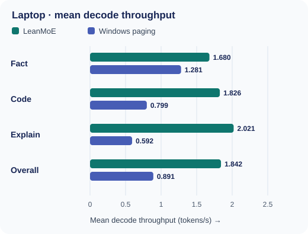
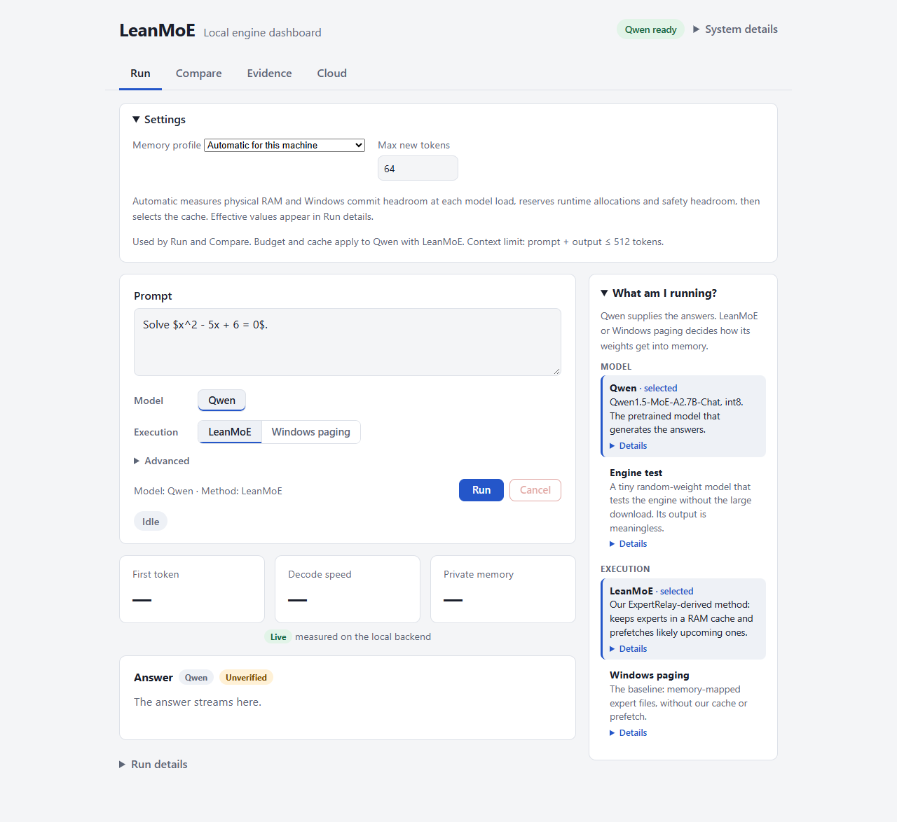
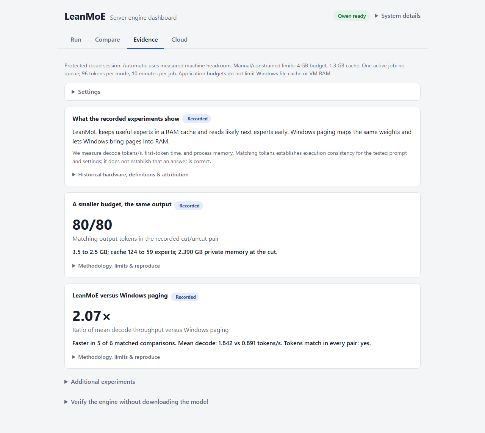

# LeanMoE

**Run a Qwen mixture-of-experts model on memory-constrained Windows machines by keeping useful experts in RAM and reading the rest as needed.**

[Live Demo](https://leanmoe-demo-1.eastus.cloudapp.azure.com/) · [Presentation](docs/presentation/LeanMoE-Presentation-Visual-v5.pptx) · [Quick Start](#verify-without-downloading-the-model) · [Results](#recorded-laptop-results) · [Tests](#tests-and-evidence)

Windows only · Python 3.13 tested · Qwen1.5-MoE-A2.7B-Chat int8

The live demo runs the **same engine and model store on a Windows cloud server**; your browser needs no model download. It requires credentials supplied by the demo owner. The local dashboard stays on `127.0.0.1` and does not expose an unauthenticated inference server.

[How it works](#how-it-works) · [Laptop evidence](#recorded-laptop-results) · [Task-success evaluation](docs/TASK_BENCHMARK.md) · [Cloud results](#cloud-deployment-and-results) · [Verify locally](#verify-without-downloading-the-model) · [Full Qwen setup](#use-the-full-qwen-model) · [Tests and evidence](#tests-and-evidence) · [Ownership and limits](#ownership-and-limits)

## How it works

Qwen supplies the pretrained model and its answers. **LeanMoE supplies the execution method** for local inference. A mixture-of-experts model routes each token through only a few of its experts:

1. **Cache selected experts.** Keep recently useful weights in RAM; fetch misses from the int8 store. [How caching works ↓](#how-caching-works)
2. **Prefetch likely next experts.** Start the next read before the model reaches that layer. [How prefetching works ↓](#how-prefetching-works)
3. **Adapt while generating.** Resize the expert cache between tokens when its planning budget changes. [How adaptation works ↓](#how-adaptation-works)

```text
Prompt → Qwen router → selected experts → next token
                         │
                         ├─ RAM cache: reuse loaded experts
                         └─ SSD store: read misses; prefetch likely next experts
```

### How caching works

The 14.36 GB int8 **store size is disk space**, not required RAM. Shared weights and the active expert cache use memory; the remaining experts stay on disk. [Windows paging](#recorded-laptop-results) is the comparison: it memory-maps the same store and lets Windows manage file pages. See the [recorded method and memory definitions](results/EVIDENCE.md).

### How prefetching works

The predictor starts reading likely next experts while computation continues. The cache, unbuffered reads and predictor were developed in **ExpertRelay**, then reused here; LeanMoE did not invent those engine mechanisms. The [prefetch ablation](results/EVIDENCE.md#prefetch-on-versus-off-evalprefetch_ablationpy) measures a specific earlier configuration, rather than proving every run benefits.

### How adaptation works

ExpertRelay's LiveBudget can shrink or grow the cache between tokens. LeanMoE records a real-model budget cut, checks its output against an uncut run, and adds a machine-aware automatic dashboard profile. The budget is a **planning target, not a hard limit** on process memory, Windows file cache or physical RAM. [Resource-profile details](deploy/RESOURCE_PROFILE.md) explain the reserve and headroom checks.

[↑ Back to top](#leanmoe)

## Recorded laptop results

These are **recorded**, not live benchmarks: one Windows laptop (Intel Core i5-12450H, 8.30 GB physical RAM), the Qwen int8 Chat store, NumPy/fused int8 compute and greedy decoding. The [evidence index](results/EVIDENCE.md) describes settings, order, timing, memory and limits.

| Experiment | Recorded result | Sources |
|---|---|---|
| LeanMoE cache + prefetch versus Windows paging | Mean decode **1.842 vs 0.891 tokens/s**; ratio of means **2.07×**; LeanMoE faster in **5 of 6 matched runs**. Three prompts, two runs per mode. | [Paging comparison](results/config_compare_mmap_full_20261030-060448.json) · [method](results/EVIDENCE.md#blas-threads-and-memory-mapping-evalconfig_comparepy) |
| Budget cut during one prompt | **80/80 output token IDs match** the uncut reference. Budget 3.5 → 2.5 GB after token 20; cache 124 → 59 experts; measured private memory after the cut 2.390 GB. | [Uncut reference](results/adaptive_demo_20261030-060626.json) · [Adaptive run](results/adaptive_demo_20261030-060728.json) · [method](results/EVIDENCE.md#budget-cut-demo-evaladaptive_demopy) |

**2.07× is the ratio of the six-run mean rates**, not the average of six speedup ratios. The cache was faster in five matched runs; a warm paging run beat its cached partner. Windows' file cache was not cleared. The 80/80 pair establishes output consistency for that prompt and configuration; **matching tokens do not establish that the answer is correct**. [Raw settings and caveats](results/EVIDENCE.md) remain available.



*Laptop decode throughput. Each prompt mean uses two runs per mode; “Overall” uses six. Higher is faster. [Raw comparison](results/config_compare_mmap_full_20261030-060448.json) · [Chart generator](docs/readme/decode_chart.py).*

| Prompt | LeanMoE, mean tokens/s | Windows paging, mean tokens/s |
|---|---:|---:|
| Fact | 1.680 | 1.281 |
| Code | 1.826 | 0.799 |
| Explain | 2.021 | 0.592 |
| **Overall** | **1.842** | **0.891** |

[↑ Back to top](#leanmoe)

## Cloud deployment and results

The [authenticated demo](https://leanmoe-demo-1.eastus.cloudapp.azure.com/) runs the real Qwen store and the same engine remotely. Its **Automatic for this machine** profile measures backend RAM and Windows commit headroom; **Constrained adaptation experiment** retains the deliberate laptop-sized settings. The [raw same-VM comparison](results/resource_profile_comparison.json) used the same model, prompt, kernel and thread settings, with two 16-token main repeats per mode:

| Existing 16 GiB VM configuration | Actual expert cache | Mean decode tokens/s | Peak sampled working set |
|---|---:|---:|---:|
| LeanMoE, constrained | 1.197 GB | 0.304 | 2.94 GB |
| LeanMoE, automatic | 10.969 GB | 1.998 | 12.72 GB |
| Windows paging | OS-managed | **2.198** | 13.29 GB |

Automatic sizing fixed the inherited small-cache configuration and improved LeanMoE decode **6.58×** over that constrained run. **Paging remained about 10% faster** on this VM. These practical configurations used unequal memory; an application cache budget does not cap Windows' total file cache. This is no cloud speedup claim. [Method, I/O, memory samples and limitations](deploy/RESOURCE_PROFILE.md) · [Earlier small-cache diagnosis, preserved](deploy/DIAGNOSIS.md) · [Deployment and recovery](deploy/README.md).

[↑ Back to top](#leanmoe)

## Verify without downloading the model

**Requirements:** 64-bit Windows 10 or 11, Git, internet for package installation, and Python **3.13** (tested on Windows 11 with 3.13.14). The setup script accepts Python 3.10–3.12 but those versions are untested. Linux and macOS cannot run the Windows unbuffered-I/O engine.

Copy into **PowerShell**:

```powershell
git clone https://github.com/No6Name8/LeanMoE.git
cd LeanMoE
powershell -NoProfile -ExecutionPolicy Bypass -File scripts\setup.ps1
.\.venv\Scripts\python.exe -m pytest
powershell -NoProfile -ExecutionPolicy Bypass -File scripts\dashboard.ps1
```

`git clone` gets the source; [setup.ps1](scripts/setup.ps1) creates **`.venv` (with the dot)**, installs dependencies and should end with `Setup complete.` The test command exercises the tiny generated engine store and saved-evidence checks; look for a pytest pass/skip summary, not a fixed live count. [dashboard.ps1](scripts/dashboard.ps1) opens `http://127.0.0.1:8770`; stop it with Ctrl+C. Neither setup nor the synthetic checks download Qwen weights.

Without the full store, the dashboard says **Qwen store not found**. Choose **Engine test** under Advanced to exercise the real engine on tiny random weights. Its output is meaningless and **does not provide Qwen answers**. The older development environment called `venv` is separate; a fresh clone and both launch scripts use `.venv`.



*Local Run view. The machine profile selects a cache at model load; the live figures appear during a real run. [Phone view](docs/screenshots/resources-phone.png).*

[↑ Back to top](#leanmoe)

## Use the full Qwen model

The Qwen1.5-MoE-A2.7B-Chat int8 store is **not in GitHub** and has no prebuilt LeanMoE download. Allow **14.36 GB on disk plus margin** and sufficient physical/Windows commit headroom; more free RAM can support a larger cache. Set the root to the folder *containing* `qwen1.5-moe-a2.7b-chat-int8`, in the **same PowerShell window** as the launch command:

```powershell
$env:LEANMOE_MODELS_ROOT = 'D:\leanmoe-models'  # replace with your actual parent folder
.\.venv\Scripts\python.exe scripts\preflight.py --require-model
powershell -NoProfile -ExecutionPolicy Bypass -File scripts\dashboard.ps1
```

With an **existing, complete store**, preflight and dashboard launch were verified on the development laptop; the cloud release verifies its own store manifest before serving. [preflight.py](scripts/preflight.py) reports missing files, disk and memory information. The path above is an example, not an installed location. The local dashboard stays on this computer.

<details>
<summary>Build the store if you do not already have it — not yet verified from a fresh LeanMoE clone</summary>

The [ExpertRelay-derived builder](src/engine/store/build_store.py) streams and converts the upstream bf16 [Qwen checkpoint](https://huggingface.co/Qwen/Qwen1.5-MoE-A2.7B-Chat) at revision `ec052fda178e241c7c443468d2fa1db6618996be`. The earlier ExpertRelay build transferred 28.6 GB and did not retain that source checkpoint; its duration is not a promise for a new machine. Review the upstream model license and preserve its notices when handling a store. These commands are **documented but unverified as an end-to-end LeanMoE rebuild**:

```powershell
$env:LEANMOE_MODELS_ROOT = 'D:\leanmoe-models'  # replace this parent folder
.\.venv\Scripts\python.exe -m src.engine.store.build_store --repo-id Qwen/Qwen1.5-MoE-A2.7B-Chat --revision ec052fda178e241c7c443468d2fa1db6618996be --store-dir "$env:LEANMOE_MODELS_ROOT\qwen1.5-moe-a2.7b-chat-int8"
.\.venv\Scripts\python.exe -m src.engine.store.build_store --verify --store-dir "$env:LEANMOE_MODELS_ROOT\qwen1.5-moe-a2.7b-chat-int8"
.\.venv\Scripts\python.exe scripts\preflight.py --require-model
powershell -NoProfile -ExecutionPolicy Bypass -File scripts\dashboard.ps1
```

</details>

<details>
<summary>Common setup problems</summary>

| Symptom | Fix |
|---|---|
| No Python 3.10–3.13 found | Install Python 3.13 with the `py` launcher or on PATH, then rerun setup. |
| `.venv` missing | Run [setup.ps1](scripts/setup.ps1); the older `venv` folder does not satisfy the launcher. |
| Qwen store not found | Download/build the store and set `LEANMOE_MODELS_ROOT` to its **parent** folder in the same shell. Run preflight with `--require-model`. |
| Port 8770 in use | Launch with `powershell -NoProfile -ExecutionPolicy Bypass -File scripts\dashboard.ps1 -Port 8771`. |
| Scripts are disabled | Use the exact `powershell -NoProfile -ExecutionPolicy Bypass -File ...` lines above; this affects only that process. |
| Low memory or commit headroom | Close other workloads, choose a smaller manual cache, or retry when Automatic has headroom. The planning budget is not a hard ceiling. |

</details>

[↑ Back to top](#leanmoe)

## Tests and evidence

The first `pytest` command above checks the engine on a **tiny synthetic store**, the dashboard, access/isolation behavior and saved evidence. It does **not** rerun the Qwen benchmarks or grade model answers. As a recorded release check for commit [`9de41e5`](https://github.com/No6Name8/LeanMoE/commit/9de41e5626272e238c8010902e9aba639571bd22), the Windows VM reported **190 passed, 3 skipped** (Node.js was absent there); the three page-render checks passed on the development machine. These are historical test results, not a live status badge.

Check the **saved** 80-token adaptation pair without model weights:

```powershell
.\.venv\Scripts\python.exe eval\compare_artifacts.py results\adaptive_demo_20261030-060626.json results\adaptive_demo_20261030-060728.json
```

The [strict checker](eval/compare_artifacts.py) verifies the recorded cut, settings and matching token IDs; a passing result does **not** run new inference or prove the answer is correct. The [task-success evaluation](docs/TASK_BENCHMARK.md) fixes 12 questions and reports the earlier three-task pilot separately from any later completed run. [Evidence index](results/EVIDENCE.md) · [Raw laptop paging comparison](results/config_compare_mmap_full_20261030-060448.json) · [Raw cloud comparison](results/resource_profile_comparison.json) · [Design decisions](DECISIONS.md).



*Recorded evidence in the current cloud dashboard. Open each card for methodology and limitations; live machine details are separate. [Phone view](docs/readme/evidence-phone.png).*

<details>
<summary>More source and verification paths</summary>

- [Run a real-model adaptive demo](eval/adaptive_demo.py) and compare its output using the checker above; this requires the complete store. [Command-line synthetic streaming example](eval/stream_demo.py).
- [Prefetch comparison runner](eval/prefetch_ablation.py) and [paging/thread comparison runner](eval/config_compare.py) created the historical laptop artifacts; reproduction details and older configurations are in the [evidence index](results/EVIDENCE.md).
- [Cloud deployment, recovery and teardown](deploy/README.md), [resource profile](deploy/RESOURCE_PROFILE.md), [engine source adapted from ExpertRelay](src/engine/), [dashboard source](src/dashboard/) and [automated tests](tests/).
- [Run with a live budget change](docs/screenshots/run-budget-change.png), [mode comparison](docs/screenshots/compare.png) and [cloud dashboard](docs/screenshots/cloud-desktop.png) are additional recorded interface views. Their live values depend on machine and configuration.

</details>

[↑ Back to top](#leanmoe)

## Ownership and limits

The engine in [src/engine/](src/engine/) is adapted from **ExpertRelay**, Abdullah Ali Alanazi's earlier private research project (2026); see its [concept note](https://doi.org/10.5281/zenodo.22980838) and the source attribution headers. ExpertRelay supplied the int8 store format/readers, fused NumPy runtime, expert cache, predictor, LiveBudget and startup guard. LeanMoE ports and integrates that work for one Windows machine, evaluates the real Qwen Chat store, corrects memory accounting, adds streaming/dashboard/evidence and protected cloud access, and measures automatic cache sizing. [Decision record](DECISIONS.md) separates prior mechanisms from submission changes. [Visual v5](docs/presentation/LeanMoE-Presentation-Visual-v5.pptx) is the current deck; its task-success slide still describes the unfinished full evaluation as future work. A final demo recording is outstanding.

These measurements cover limited prompts and hardware. Windows file caching and background load affect timing; a fresh process is not a cold OS cache. Memory samples can miss short peaks. The Qwen model can answer incorrectly even when both execution modes emit identical tokens. Neither lower energy use nor fewer arithmetic operations has been measured here. The cloud comparison is not an equal-memory experiment, and the full task-success study is unfinished.

[↑ Back to top](#leanmoe)
